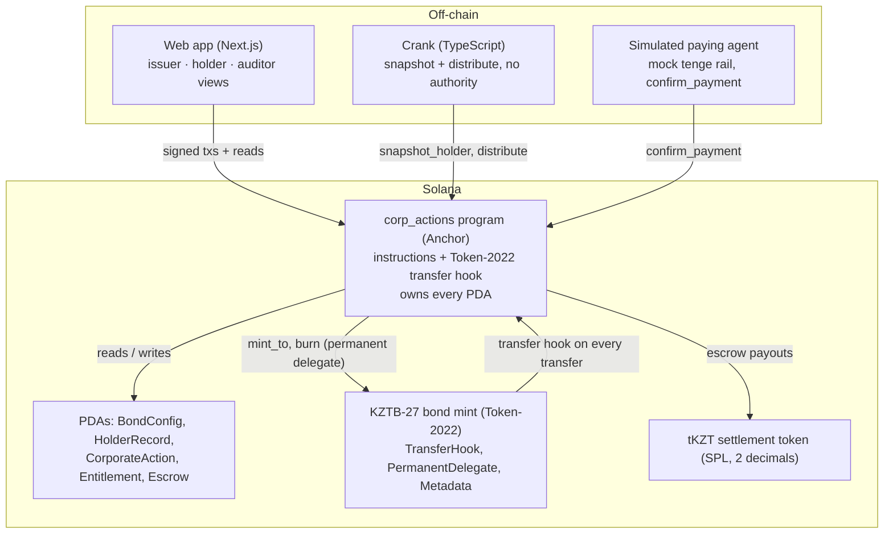
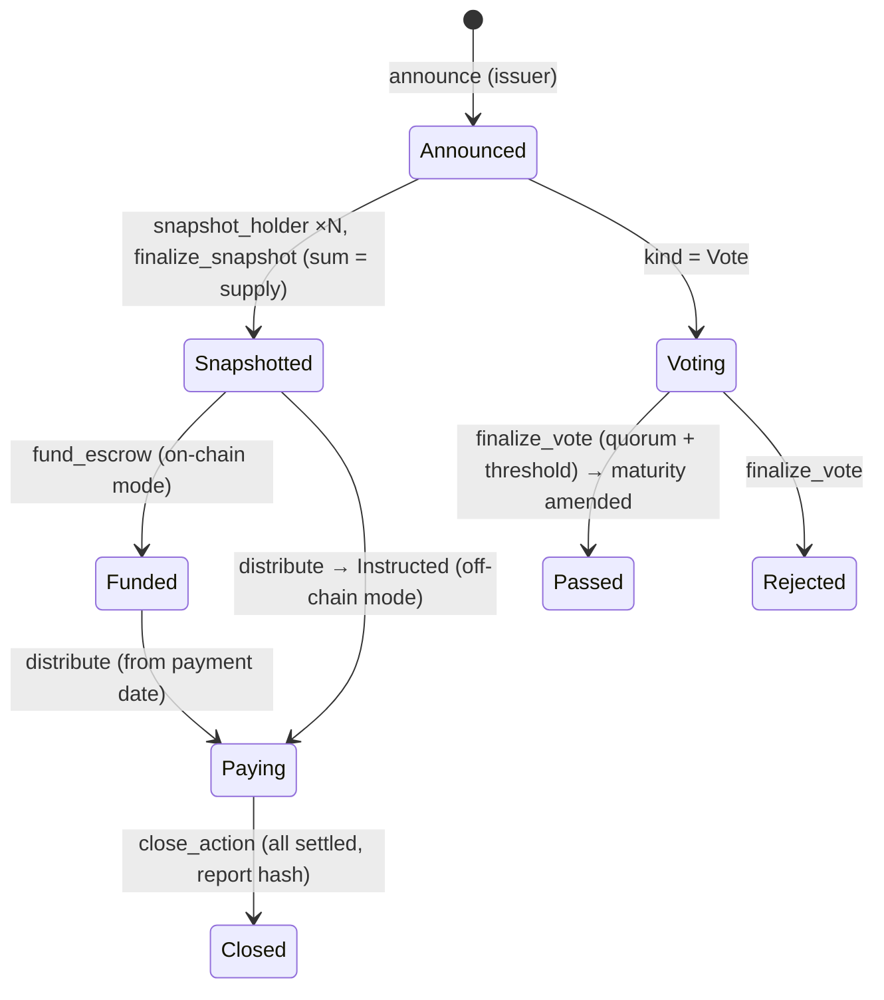

# Morro: technical overview

Morro runs a tokenized bond's corporate actions on Solana from end to end: it identifies holders at the record date, calculates entitlements, settles them, and records the outcome on-chain. One Anchor program (`corp_actions`) owns the holder registry, record-date snapshots, entitlements, settlement escrows and votes. It is also the bond mint's Token-2022 transfer hook.

Built for the [Superteam Kazakhstan x KASE side track](https://superteam.fun/earn/listing/superteam-kazakhstan-x-kase-side-track-corporate-actions-on-blockchain) of the Colosseum hackathon.

| Listing requirement | Where it lives |
| --- | --- |
| Test tokenized financial instrument | KZTB-27 Token-2022 mint: [`sdk/src/mint.ts`](../sdk/src/mint.ts), checked in `initialize_bond` ([`bond.rs`](../programs/corp_actions/src/instructions/bond.rs)) |
| Holder registry | `HolderRecord` PDAs ([`state.rs`](../programs/corp_actions/src/state.rs)), kept current by the transfer hook ([`hook.rs`](../programs/corp_actions/src/instructions/hook.rs)) |
| Record-date mechanism | Balance and supply checkpoints ([`state.rs`](../programs/corp_actions/src/state.rs) `Checkpoints`); `snapshot_holder` / `finalize_snapshot` ([`actions.rs`](../programs/corp_actions/src/instructions/actions.rs)) |
| Entitlement calculation | [`math.rs`](../programs/corp_actions/src/math.rs) (30/360, Act/365, integer floor), mirrored in [`sdk/src/math.ts`](../sdk/src/math.ts) for previews |
| Coupon payment | `announce` → `snapshot_holder` → `finalize_snapshot` → `fund_escrow` → `distribute` → `close_action` |
| Bond redemption | Same flow; `distribute` pays principal + final coupon and burns the bonds in one instruction ([`settlement.rs`](../programs/corp_actions/src/instructions/settlement.rs)) |
| Additional corporate action | Bondholder consent vote that moves maturity on-chain and in token metadata ([`vote.rs`](../programs/corp_actions/src/instructions/vote.rs)); also pro-rata partial early redemption |
| Verifiable on-chain record | `CorporateAction` and `Entitlement` accounts, Anchor CPI events, snapshot digest and report hash ([`sdk/src/report.ts`](../sdk/src/report.ts), [`sdk/src/events.ts`](../sdk/src/events.ts)) |
| Simulated external rails | Off-chain settlement mode plus a simulated paying agent ([`sdk/src/paying-agent.ts`](../sdk/src/paying-agent.ts)) |

## Architecture



Off-chain services only submit transactions. Snapshotting and distribution need no permission, so if the crank stops, anyone can run the same calls.

## On-chain data model

| Account | Seeds | Purpose |
| --- | --- | --- |
| `BondConfig` | `["bond", mint]` | Terms (face value, coupon bps, frequency, day count, maturity), roles (issuer, registrar, paying agent), supply and supply history, pending record dates, redemption transfer lock |
| `HolderRecord` | `["holder", mint, owner]` | KYC flag, frozen flag, current balance, balance history (32 checkpoints) |
| `CorporateAction` | `["action", mint, action_id u32 LE]` | Kind, status, settlement mode, dates, parameters, snapshot totals, payment totals, vote tallies, snapshot digest, report hash |
| `Entitlement` | `["ent", action, owner]` | Balance at the record date, cash owed, bonds to retire, status (Pending, Instructed, Paid), payment ref, vote |
| Escrow | `["escrow", action]` | tKZT token account owned by the action PDA |
| `ExtraAccountMetaList` | `["extra-account-metas", mint]` | Tells Token-2022 to pass `BondConfig` and both `HolderRecord`s to the hook, derived from the `owner` field (bytes 32..64) of each token account |

The bond mint uses decimals 0, so 1 token equals 1 bond. Its extensions are:

- **TransferHook**, pointing to the `corp_actions` program.
- **PermanentDelegate**, set to the BondConfig PDA. It lets the program burn bonds at redemption.
- **MetadataPointer + TokenMetadata**: name, symbol, issuer, coupon, face value and maturity.

The mint authority and the metadata update authority are both moved to the BondConfig PDA.

## Record-date logic

Morro takes a true point-in-time record date: holders are not judged by what they hold at payment, and trading never stops for a coupon.

- Every balance change writes a `(unix_ts, balance)` checkpoint:
  - transfers through the transfer hook;
  - issuance and burns inside the `issue` / `distribute` / `confirm_payment` instructions, because Token-2022 does not run hooks on mint or burn.
- The bond's total supply keeps its own checkpoint history.
- The hook acts only during a real transfer. It checks the source account's `TransferHookAccount.transferring` flag, so calling it directly does nothing.
- `snapshot_holder` can run once `now > record_ts` and anyone may call it. It reads the holder's balance as of `record_ts` (binary search over checkpoints), writes the `Entitlement`, and folds `(owner, balance, amount)` into a running SHA-256 `snapshot_digest`.
- `finalize_snapshot` succeeds only if the sum of snapshotted balances equals the supply as of `record_ts`. This proves on-chain that no holder was missed, without enumerating accounts.
- **History safety.** The history ring holds 32 checkpoints. The hook refuses to evict the oldest checkpoint if a still-open record date falls inside the window that checkpoint covers. Such a transfer fails with `CheckpointHistoryFull` until that snapshot is finalized.
- **Ex-date.** On-chain transfers settle instantly (T+0), so the ex-date equals the record date.
- **Redemptions.** From a redemption's record date, the hook rejects transfers and `issue` is blocked. Each holder therefore still holds exactly the bonds that will be burned. `close_action` lifts the lock.

## Entitlement calculation

Entitlements are integer tiyn (1 KZT = 100 tiyn), computed in u128 with one floor per holder:

```
coupon_i = floor(B_i × face × rate_bps × n / (10,000 × d))
```

`n / d` is the day-count fraction for the coupon period:

| Convention | n / d |
| --- | --- |
| 30/360 (bond basis) | `360×ΔY + 30×ΔM + ΔD` / 360, with day 31 treated as 30 |
| Act/365 | actual days / 365 |

- **Redemption**: `B × face + coupon`; B bonds burned.
- **Partial redemption**: `floor(B × redeem_bps / 10,000)` bonds retired, paid at face.
- **Vote weight**: B.

The escrow is funded with exactly the sum of the floored amounts, so it can never come up short.

**Worked example** (asserted in tests): KZTB-27 has face value 1,000 KZT and pays 14.50% semi-annually on 30/360. One 180/360 period gives **72.50 KZT per bond**. A holder with 10,000 bonds at the record date receives 725,000.00 KZT.

## Lifecycle



| Scenario | Instructions | Signers |
| --- | --- | --- |
| Coupon | `announce` → `snapshot_holder` ×N → `finalize_snapshot` → `fund_escrow` → `distribute` ×N → `close_action` | Issuer announces, funds and closes; the crank does the rest |
| Redemption | Same, with `kind = Redemption`; `distribute` pays principal + final coupon and burns | Same |
| Consent vote | `announce` (new maturity, quorum, threshold, end) → snapshot → `cast_vote` ×N → `finalize_vote` | Holders sign their votes; anyone finalizes |
| Partial redemption | Same as redemption with `redeem_bps`; demonstrated with off-chain settlement | Paying agent confirms |

Voting rules:

- Quorum is measured against supply at the record date.
- The threshold is measured against votes cast.
- Each holder votes once, and the vote is final.

If the vote passes, `finalize_vote` updates `BondConfig.maturity_ts` and rewrites the mint's `maturity` metadata field, signing through CPI as the metadata update authority.

## Settlement

**On-chain mode.** Payment follows these steps:

1. The issuer pre-funds a per-action escrow PDA with `total_entitlement` tKZT.
2. From `payment_ts`, the crank pushes each holder's payment with `distribute`. Holders never need to sign.
3. For redemptions, the same instruction burns the holder's bonds through the permanent delegate. Payment and retirement are atomic (delivery versus payment).
4. `Entitlement.status` makes a second payment to the same holder fail.

**Off-chain mode** (simulated rails, as the listing allows):

1. `distribute` marks each entitlement as Instructed and emits a payment instruction.
2. The simulated paying agent "pays" on a mock tenge rail and records the payment in `.demo/rail-ledger.json`.
3. The agent calls `confirm_payment` with the SHA-256 of the rail reference. Only the `paying_agent` key can do this. Bonds to be retired are burned on confirmation.

**Close.** `close_action` requires every entitlement to be settled. It returns any escrow remainder, closes the escrow and stores the hash of the closing report. After a full redemption, the bond becomes `Redeemed`, and from then on the hook rejects every transfer.

## Verifiability

An auditor can check any action from chain data alone:

- **Accounts**: the `CorporateAction` and `Entitlement` accounts stay on-chain.
- **Events**: every state change emits an Anchor CPI event (`emit_cpi!`), so it survives log truncation. The events are ActionAnnounced, HolderSnapshotted, SnapshotFinalized, EscrowFunded, EntitlementPaid, PaymentInstructed, PaymentConfirmed, BondsRetired, VoteCast, VoteFinalized, TermsAmended and ActionClosed. `sdk/src/events.ts` decodes them from transaction inner instructions.
- **Snapshot digest**: replaying the HolderSnapshotted events must reproduce `snapshot_digest`.
- **Report hash**: the closing report (`morro.action-report/v1`) is deterministic JSON, and its SHA-256 is stored on the action.
- **Invariants**:
  - Σ balances = supply at the record date.
  - Σ amounts = `total_entitlement` = escrow funding = `total_paid`.
  - Supply is 0 after a full redemption.

## Security and roles

| Risk | Mitigation |
| --- | --- |
| Bonds reach an unverified wallet | Hook rejects any receiver without an approved HolderRecord (`ReceiverNotApproved`) |
| Hook called directly to forge history | Hook requires the Token-2022 `transferring` flag (`NotTransferring`) |
| Holder paid twice | Entitlement status check (`InvalidEntitlementStatus`) |
| A holder missed in a snapshot | `finalize_snapshot` requires Σ balances = supply at record (`SnapshotIncomplete`) |
| Escrow short of cash | Escrow exists only once funded with the full `total_entitlement` |
| History needed by an open record date gets evicted | Eviction guard (`CheckpointHistoryFull`) |
| Balances change between redemption record and payment | Transfer and issuance lock from the record date (`TransfersLocked`) |
| Sanctions or court order | Registrar can freeze a holder; the hook blocks frozen senders and receivers |
| Crank goes offline | Snapshot, finalize and distribute are permissionless |
| Wrong party confirms an off-chain payment | Only `paying_agent` can confirm (`NotPayingAgent`) |

The roles are issuer, registrar, paying agent and admin (the program upgrade authority, a multisig in production). Each is a separate key in `BondConfig`.

## Testing

| Suite | Command | Covers |
| --- | --- | --- |
| Rust unit tests (9) | `npm run test:unit` | Day count and the doc's worked example, checkpoint lookup and eviction guard, vote quorum and threshold |
| LiteSVM integration (21) | `npm run test:integration` | The full lifecycle with clock warping. KYC, freeze, record-date trades before and after, incomplete snapshot rejected, digest replay, funding and payment-date gates, double payment rejected, report hash, consent vote and metadata amendment, transfer lock, off-chain confirmation with burns, full redemption, bond Redeemed |
| Live end-to-end | `npm run e2e:live` | The same flows in real time on a running validator, through the crank and paying-agent code, with events fetched from RPC and digest and report hash re-verified |

## Limitations and next steps

- Settlement uses tKZT, a test SPL token. Production would use a regulated tenge stablecoin or tokenized deposits, or keep cash on existing rails through off-chain mode.
- KYC is a registrar attestation stored on-chain. Production would link it to the depository's investor records.
- The demo web app signs with server-held demo keys. A production front end would use the participants' own wallets and custody.
- The program does not stop an issuer redeeming before maturity (a call). The UI defaults redemption dates to maturity.
- Tax withholding, multiple bond accounts per holder, and Merkle-claim distribution for very large holder bases are not implemented.
